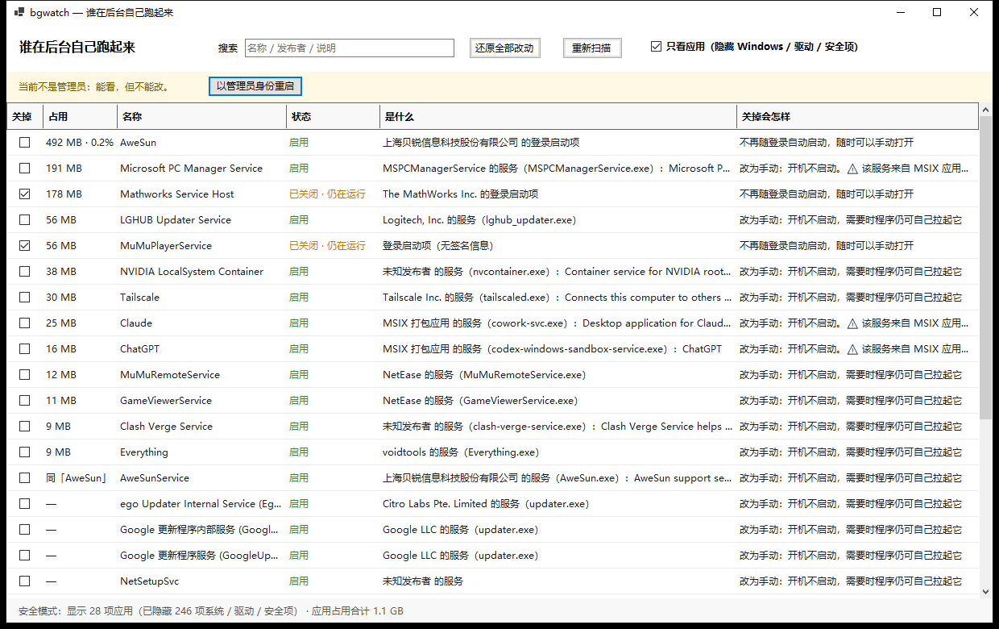

# bgwatch

**See what starts itself in the background. One screen, one toggle, one-click undo.**

[中文说明](README.zh-CN.md) · English

---

Most "cleaner" tools either drown you in 300 rows of registry paths, or silently
delete things you can't get back. bgwatch answers three questions on a single screen:

1. **What starts itself?** — services, logon entries, scheduled tasks, startup folder
2. **How much is it using right now?** — sorted by memory, not by type
3. **What happens if I turn it off?** — one sentence per row

> The UI is currently Chinese-only. This README is bilingual.



---

## Safe mode is on by default

A checkbox at the top hides everything that belongs to Windows itself:

| | Items | |
|---|---|---|
| **Apps (shown)** | 28 | third-party startup entries, services, updaters |
| **System / driver / security (hidden)** | 245 | Windows components, hardware driver services, antivirus |

Hidden by default:

1. Windows core services (`RpcSs`, `LSM`, `lsass` dependency chain …)
2. Hardware driver services (`C:\Windows\System32\DriverStore\…`)
3. Security products (Defender, 360, Huorong, Kaspersky …)
4. Microsoft built-in scheduled tasks (`Microsoft\Windows\…`)

**None of the 28 visible items can break your PC.** The worst case is that some app
does not start by itself — and you can always turn it back on.

Critical items stay unclickable even in full mode. That check lives in the writer layer,
not in the UI, so it cannot be bypassed.

---

## What it changes

| Type | Action | Undo |
|---|---|---|
| Service | `sc config <name> start= demand` (**auto → manual**, never `disabled`) | restore original start type |
| Logon entry | write the disable marker into `Explorer\StartupApproved\Run` | restore original bytes or delete |
| Scheduled task | COM, `Enabled = false` | restore |
| Startup folder | move the file into `%LOCALAPPDATA%\bgwatch\quarantine\` | move back |

Three hard rules:

1. **The `Run` key itself is never touched.** Only `StartupApproved`. Before writing,
   bgwatch verifies the value is still a command string — if not, it stops.
2. **Services go to manual, never disabled.** The program can still start them on demand.
3. **If you can't undo it, it doesn't happen.** Moving a startup-folder file requires a
   write probe on the source directory first; if that fails, the operation is refused.

> "Disabled but still running" is shown explicitly. Turning off an autostart entry does
> **not** kill the process that is already running — that only happens after a reboot.

---

## Requirements

- Windows 10 / 11 (x64)
- **.NET 10 Desktop Runtime** — [download](https://dotnet.microsoft.com/download/dotnet/10.0/runtime)
  (the installer checks for it and tells you if it's missing)

## Install

Grab from [Releases](../../releases):

| File | Size | |
|---|---|---|
| `bgwatch-1.0.0-setup.exe` | 0.35 MB | installer (NSIS wizard, no admin needed) |
| `bgwatch.exe` | 0.85 MB | portable single file |
| `SHA256SUMS.txt` | — | verify integrity: `Get-FileHash bgwatch.exe -Algorithm SHA256` |

The installer places the app in `%LOCALAPPDATA%\Programs\bgwatch`.
Uninstalling **keeps** `%LOCALAPPDATA%\bgwatch` (undo records + quarantined files), so a
reinstall can still revert earlier changes.

### It is not code-signed

Windows SmartScreen may warn when the file is downloaded from the internet. Locally built
copies are unaffected. To verify what you downloaded, compare against `SHA256SUMS.txt`.

Self-signed certificates do **not** help — they still warn on everyone else's machine.

---

## Command line

```
bgwatch.exe --dump out.txt        read-only: dump the scan to a text file
bgwatch.exe --off  "name"         disable one item
bgwatch.exe --on   "name"         restore one item
```

## Build

```powershell
powershell -ExecutionPolicy Bypass -File build.ps1                    # app only
powershell -ExecutionPolicy Bypass -File build.ps1 -Installer         # + NSIS installer
powershell -ExecutionPolicy Bypass -File build.ps1 -Installer -DownloadNsis
powershell -ExecutionPolicy Bypass -File build.ps1 -Portable          # self-contained ~150MB
```

Requires the .NET 10 SDK. The installer step needs [NSIS](https://nsis.sourceforge.io)
(3.x). The build runs a `--dump` smoke test and refuses to package if the scan pipeline
is broken.

## Structure

```
src/BgWatch/
  Models.cs     item model, critical-service list, security-product detection
  Util.cs       path / command-line parsing, version info, .lnk resolution
  Scanner.cs    four sources + process sampling + usage de-duplication
  Changer.cs    modifications + undo (single undo.json)
  MainForm.cs   one window, one grid
  Program.cs    entry point + --dump/--off/--on
installer/      NSIS script + icon generator
tools/          NSIS portable (not committed)
```

~1,600 lines. No UI framework, no compositor, no installer runtime.

## License

MIT — see [LICENSE](LICENSE).
