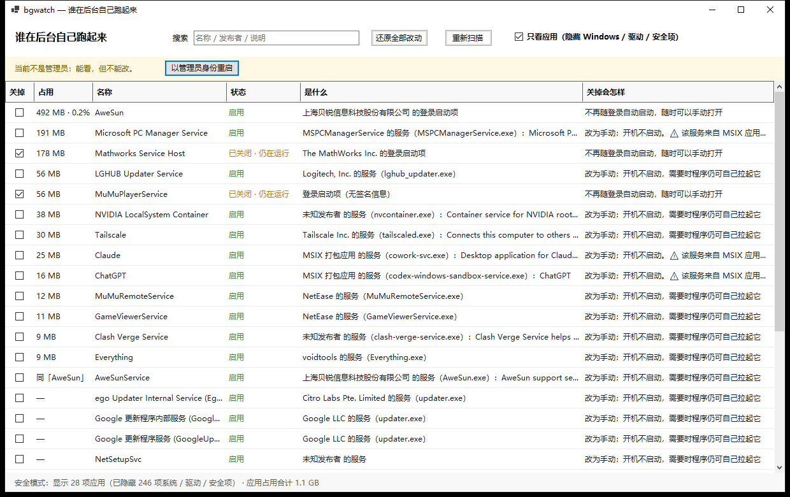

# bgwatch

**看谁在后台自己跑起来。一屏看完，一行关掉，一键还原。**

中文 · [English](README.md)

---

多数"清理/优化"工具要么甩给你 300 行注册表路径，要么悄悄删掉你再也拿不回来的东西。
bgwatch 只在**一个界面**上回答三个问题：

1. **有什么会自己启动？** —— 服务、登录启动项、计划任务、启动文件夹
2. **它此刻占多少？** —— 按内存排序，不是按类型
3. **关掉会怎样？** —— 每行一句话



---

## 安全模式：默认开启

顶部勾选框会把属于 Windows 本身的东西全部隐藏：

| | 条数 | |
|---|---|---|
| **应用类（显示）** | 28 | 第三方程序的启动项、服务、更新器 |
| **系统 / 驱动 / 安全（隐藏）** | 245 | Windows 组件、硬件驱动配套、杀毒防病毒 |

默认隐藏的四类：

1. Windows 核心服务（`RpcSs`、`LSM`、`lsass` 依赖链 …）
2. 硬件驱动配套服务（`C:\Windows\System32\DriverStore\…`）
3. 安全防护组件（Defender、360、火绒、卡巴 …）
4. 微软内置计划任务（`Microsoft\Windows\…`）

**这 28 项里没有任何一项能让电脑起不来。** 最坏结果是某个软件不自动启动了，随时能开回去。

系统关键项即使在完整模式里也点不动 —— 这条检查在**写入层**，不是在界面层，绕不过去。

---

## 它改什么

| 类型 | 动作 | 还原 |
|---|---|---|
| 服务 | `sc config <name> start= demand`（**自动 → 手动**，从不设 disabled） | 写回原启动类型 |
| 登录启动 | 写 `Explorer\StartupApproved\Run` 的禁用标记 | 写回原字节或删除 |
| 计划任务 | COM 设 `Enabled = false` | 恢复 |
| 启动文件夹 | 文件移到 `%LOCALAPPDATA%\bgwatch\quarantine\` | 移回 |

三条硬规矩：

1. **绝不碰 `Run` 键本身**，只动 `StartupApproved`。写之前还会确认该值仍是命令字符串，不是就停手。
2. **服务只降到"手动"**，不设 disabled —— 程序仍能按需拉起，风险最低。
3. **还原不了的事就不做**。移动启动文件夹文件前，先在源目录做一次写入探测；探测不过直接拒绝。

> 界面会明确显示「已关闭 · 仍在运行」。**禁用自启动不会终止已经在跑的进程**，
> 要重启之后才真正省下来。

---

## 环境要求

- Windows 10 / 11（x64）
- **.NET 10 桌面运行时** —— [下载](https://dotnet.microsoft.com/download/dotnet/10.0/runtime)
  （安装包会先检测，没装会提示）

## 安装

从 [Releases](../../releases) 下载：

| 文件 | 体积 | |
|---|---|---|
| `bgwatch-1.0.0-setup.exe` | 0.35 MB | 安装包（NSIS 向导，不需要管理员） |
| `bgwatch.exe` | 0.85 MB | 免安装单文件 |
| `SHA256SUMS.txt` | — | 校验完整性：`Get-FileHash bgwatch.exe -Algorithm SHA256` |

安装包装到 `%LOCALAPPDATA%\Programs\bgwatch`。
卸载会**保留** `%LOCALAPPDATA%\bgwatch`（还原记录 + 隔离文件），重装后仍能退回去。

### 没有代码签名

从网上下载时 Windows 可能弹 SmartScreen 警告；本地自己编译/拷贝的不受影响。
想确认文件没被改过，对照 `SHA256SUMS.txt`。

自签名证书**没用** —— 在别人的机器上照样报警，除非对方手动把根证书装进受信任列表。

---

## 命令行

```
bgwatch.exe --dump 结果.txt      只读：把扫描结果导出成文本
bgwatch.exe --off  "名称"        关掉某一项
bgwatch.exe --on   "名称"        还原某一项
```

## 构建

```powershell
powershell -ExecutionPolicy Bypass -File build.ps1                    # 只有主程序
powershell -ExecutionPolicy Bypass -File build.ps1 -Installer         # 额外生成安装包
powershell -ExecutionPolicy Bypass -File build.ps1 -Installer -DownloadNsis
powershell -ExecutionPolicy Bypass -File build.ps1 -Portable          # 自带运行时，约 150MB
```

需要 .NET 10 SDK；生成安装包需要 [NSIS](https://nsis.sourceforge.io) 3.x。
打包前会跑一次 `--dump` 冒烟测试，扫描管线断了就打不出包。

## 代码结构

```
src/BgWatch/
  Models.cs     数据模型 + 关键服务名单 + 安全软件识别
  Util.cs       路径 / 命令行解析 / 版本信息 / .lnk 解析
  Scanner.cs    四类扫描器 + 进程采样 + 占用去重
  Changer.cs    修改 + 撤销（一个 undo.json）
  MainForm.cs   一个窗口，一个列表
  Program.cs    入口 + --dump/--off/--on
installer/      NSIS 脚本 + 图标生成
tools/          NSIS 便携版（不入库）
```

约 1,600 行。没有 UI 框架、没有合成层、没有安装运行时。

## 许可

MIT —— 见 [LICENSE](LICENSE)。
